# Repository and how to run the code

Özgün Barış Kır (3676663). GitHub username: **ozgunbaris**. Repository: **mlds-rl-assignment2**, <https://github.com/ozgunbaris/mlds-rl-assignment2>.

All code is in the repository and `README.md` lists every command. Short version (Python 3.12, run from the repository root):

```bash
python3.12 -m venv .venv && source .venv/bin/activate
pip install -r requirements.txt
python -m pytest tests -q                                       # 11 mechanical checks
python -m dqn.cartpole_dqn --out results/cartpole/main_seed0 --seed 0 \
    --episodes 1000 --eps-final 0.1 --no-stop-when-solved \
    --eval-periodic-episodes 20                                 # (a), one seed
scripts/run_cartpole.sh                                         # (a), all 23 runs
python -m dqn.make_plots_cartpole                               # (a) figures
python -m dqn.validate_cartpole                                 # (a) validation
GPU=1 HOURS=16 SEEDS="0 1 2" ARCH=nature THREADS=1 CORES=6 MEMORY=20480 \
    EPISODES=6000 PREFIX=cluster HOLD_HOURS=12 JOB_NAME=mspacman-dqn-gpu \
    scripts/nomad/make_job.sh                                   # (b) Nomad job, 3 seeds
scripts/fetch_cluster_results.sh <alloc-id> mspacman-dqn-gpu    # (b) copy results back
python -m dqn.mspacman_dqn --out results/mspacman/cluster_seed0 --seed 0 \
    --arch nature --threads 1 --max-episodes 6000              # (b) one seed, without Nomad
python -m dqn.make_plots_mspacman --runs results/mspacman/cluster_seed0 \
    results/mspacman/cluster_seed1 results/mspacman/cluster_seed2 \
    --out results/mspacman/figures_cluster                      # (b) figures
python -m dqn.validate_mspacman --run results/mspacman/cluster_seed0 \
    --out results/mspacman/validation_cluster_seed0             # (b) validation
```

Every `results/*` folder holds the logs (`episodes.csv`, `heldout_q.csv`, `eval_periodic.csv`), the network weights, the roll-out rewards (`eval_rewards_*.npy`, `eval_summary_*.json`), the figures, and `validation.md` with the numbers quoted below.

**Compute.** The 23 CartPole runs ran one after another on one core of a cloud machine with 4 CPU cores and no GPU. The CartPole code has no GPU path, so part (a) uses the CPU only.

The MsPacman results come from one Nomad batch job on the lab node mlds-deepdish5. Its three seeds ran in parallel on one NVIDIA RTX PRO 5000 Blackwell GPU, with PyTorch 2.15.0 (CUDA 13.2). `scripts/nomad/make_job.sh` writes the job, and `scripts/fetch_cluster_results.sh` copies the results back.

Each seed is one sequential Python process that waits on many small GPU operations. On a laptop GPU one seed ran at 267, 248 and 224 agent steps per second with 1, 2 and 4 PyTorch threads. The job therefore gave each seed 1 thread and reserved 6 cores in total.

On deepdish5 each seed trained at 563 to 580 agent steps per second. Another job filled 40 of the node's other 42 cores from about 16:00 UTC on 7 November. Our speed then fell to 363 to 463 steps per second (observed in the job log; the cause is not tested).

Earlier MsPacman runs on the cloud machine used five shortened settings and were stopped by machine restarts. Part (b) describes them in one paragraph.

# The DQN implementation (shared by both games)

`dqn/core.py`, `dqn/replay.py` and `dqn/networks.py` are shared. One training step does the following.

1. Act $\epsilon$-greedily on the online network $Q_\theta$: a uniformly random action with probability $\epsilon$, otherwise $\arg\max_a Q_\theta(s, a)$. The exploration rate follows a piecewise-linear schedule (an $\epsilon$ scheduler).
2. Store the transition $(s, a, r, s', d)$ in the **replay buffer**. $d$ is the bootstrap mask: it is 1 only when the episode really ended (pole fell, cart left the track, game over, or a lost life in MsPacman). A time-limit truncation is not terminal: $s'$ is a real state and its value is bootstrapped (edge cases below).
3. Sample a uniform minibatch from the buffer and form the **Double DQN** target with the **target network** $Q_{\bar\theta}$:
$$y = r + \gamma\,(1 - d)\,Q_{\bar\theta}\big(s', \arg\max_{a'} Q_\theta(s', a')\big).$$
The online network chooses the next action and the target network evaluates it, which removes most of the upward bias of $\max_{a'} Q_{\bar\theta}(s', a')$ (van Hasselt et al. 2016). `--no-double` gives the original DQN target.
4. Take one Adam step on the **Huber loss** between $Q_\theta(s, a)$ and $y$ ($y$ carries no gradient), with the gradient norm clipped at 10. The learning rate decays linearly (a learning-rate scheduler).
5. Copy $\theta$ into $\bar\theta$ every fixed number of updates.

The three required components are therefore a neural network ($Q_\theta$), a replay buffer (`VectorReplay`, `FrameStackReplay`) and a target network ($Q_{\bar\theta}$). Ablations that remove each of them are reported in part (a).

**Maximum Q-value plots.** For plot (i) every training episode logs, from the forward passes the agent already makes to act, the mean over the states it visited of $\max_a Q_\theta(s, a)$, the largest such value in the episode and the value of the first state. Each run also tracks the average of $\max_a Q_\theta$ over a fixed set of held-out states collected with a random policy before training (Mnih et al. 2015, Fig. 2), which does not move with the agent's own state distribution.

# Part (a): CartPole-v1

## Setup

The Q-network is a 4-128-128-2 MLP with ReLU. Its inputs are divided by $(2.4, 3, 0.21, 3.5)$, the cart-position and pole-angle failure limits and typical velocities, so that all four are of order 1. Discount factor $\gamma = 0.95$ as prescribed. Adam with learning rate $5 \times 10^{-4}$ decaying linearly to $5 \times 10^{-5}$ over the 1000 training episodes; minibatch 64; replay buffer of 50,000 transitions; updates start after 1000 steps; one update per environment step; the target network is refreshed every 500 updates. $\epsilon$ decays linearly from 1 to 0.1 between steps 1,000 and 21,000 and stays at 0.1.

Every 25 training episodes the greedy policy plays 20 evaluation episodes on a separate environment instance. The network with the best such score (ties go to the later network) is kept as the trained model; the reasons for this choice and the behaviour of the network after the last episode are part of the edge cases. After training, 500 new greedy episodes (new seeds) are rolled out with the kept network and with the final network. Five seeds were run.

## Results

**The task is solved.** The kept networks of three of the five seeds balance the pole for all 500 steps in every one of the 500 roll-out episodes (mean 500.0, standard deviation 0.0); the other two reach 500 steps in 97.8 % and 85.2 % of the episodes. In the five main runs every roll-out failure, of the kept and of the final networks, is the cart leaving the track; the pole never fell.

| seed | kept network: training episode (epsilon) | its 500 greedy roll-outs: mean (std) | share at 500 steps | network after the last episode: mean | training MA100 at the end |
|---|---|---|---|---|---|
| 0 | 950 (0.10) | 500.0 (0.0) | 100 % | 173.4 | 125.3 |
| 1 | 550 (0.31) | 495.4 (33.6) | 97.8 % | 98.0 | 85.7 |
| 2 | 275 (0.71) | 455.8 (106.0) | 85.2 % | 88.6 | 89.5 |
| 3 | 800 (0.10) | 500.0 (0.0) | 100 % | 103.9 | 88.3 |
| 4 | 175 (0.86) | 500.0 (0.0) | 100 % | 98.3 | 101.4 |

Mean over the five seeds of the kept networks' roll-out means: 490.2. One run (1000 episodes, 53,000 to 68,000 steps) takes 83 to 114 seconds on one CPU core. The figures below are those of seed 0, whose network was kept late in training (episode 950), so that its Q-values are also converged; the corresponding figures of all seeds are in `results/cartpole/figures/per_run/`.

**(i) Maximum Q-values.** The value of the visited states rises from 0 to the bound $1/(1-\gamma) = 20$ in about 600 episodes and stays there (mean of the last 100 episodes 19.72 for seed 0, 19.72 to 20.37 over the five seeds). Every step pays $+1$ and the time limit is bootstrapped, so a policy that never fails has $Q = 20$ exactly, which is where the learned values settle; the largest value of an episode is slightly above it (20.6 to 21.1 over the last 100 episodes), which is the overestimation measured in test C3. The average over the 500 fixed held-out states (taken from a random policy, so they include falling poles) settles lower, at 18.1. The held-out curve rises in steps: each step is a copy of the online network into the target network (every 500 updates), the moment when the regression target moves.

**(ii) Rewards.** The training reward is collected with $\epsilon$-greedy actions, and after step 21,000 one action in ten is random. In states where the margin is small one random push ends the episode (the trace in the tests shows a state where the wrong action is worth 6.3 against 20.7, i.e. failure within about 7 steps), so the 100-episode moving average stays near 100 even when the greedy policy is perfect. The green markers in the same figure are the greedy checks (20 separate evaluation episodes every 25 training episodes): they reach 500 already at episode 125 (seed 0; 125 to 225 for four seeds), when $\epsilon$ is still about 0.9, and fluctuate between about 100 and 500 once $\epsilon$ is at its floor. This instability is analysed in the edge cases.

**(iii) Roll-outs.** The kept network of seed 0 scores 500 in all 500 greedy episodes.

{ width=78% }

{ width=78% }

{ width=62% }

{ width=78% }

## Edge cases (part a)

- **The 500-step time limit is a truncation, not a terminal state.** CartPole-v1 returns `truncated = True` after 500 steps. The state (cart position and velocity, pole angle and angular velocity) carries no clock, so the value of a state cannot depend on how many steps happen to remain. The bootstrap mask is therefore $d = $ `terminated` only, and the target at a truncated step is $1 + \gamma \max Q(s')$, not 1. Treating the limit as terminal gives some visits of a state the target 1 and the others about 20. Test C1 measures the resulting bias on a problem where it can be computed exactly, and the `truncterm` runs measure its effect on CartPole (tests below).
- **The reward of the last step and the bound on Q.** CartPole pays $+1$ on every step, including the step on which the pole falls, so the target of a terminal transition is exactly 1 and every $Q$ lies in $[1, 1/(1-\gamma)] = [1, 20]$. The learned values respect this on the states the agent visits (19.72 at the end of seed 0); predictions above 20 are overestimation and are measured in test C3.
- **A discount factor of 0.95 makes the agent short-sighted, and the cart drifts off the track.** A failure $T$ steps ahead lowers the value by $20 \cdot 0.95^T$: by 7.2 at $T = 20$, 0.92 at $T = 60$ and 0.12 at $T = 100$. A slow drift of the cart toward the edge is therefore almost invisible to the value until it can no longer be corrected. The first trial network (600 episodes, $\epsilon$ floor 0.02, unscaled inputs; `results/cartpole/preliminary/cp_try0`) balanced the pole but lost the cart in all 500 roll-outs, after 115 steps on average, and in the five main runs every roll-out failure is a cart-position failure. The cart-position map of the kept network (Figure FIG(fig_val_position_map_main)) shows the cause: with the pole upright, the value falls to about 18 only at the left edge while moving left; the right edge is barely represented, and in states the agent never visits (fast motion near an edge) the network extrapolates up to 23.3, above the bound. The configuration whose kept networks hold the cart on the track for 500 steps combines inputs scaled to order 1, longer training, more exploration (next item) and model selection; the preliminary runs did not isolate the contribution of each.
- **Instability once the task is learned, and how the trained network is chosen.** Once the agent balances, almost every target is close to 20 and the two actions differ by very little: the median absolute action gap $|Q(s,\text{right}) - Q(s,\text{left})|$ on visited states is 0.044 (test C5). A small change of the weights then flips the greedy action in many states, so the greedy policy keeps changing even when the loss is small. The greedy checks show it (Figure FIG(cartpole_main_seed0_training)): repeatedly perfect between episodes 125 and 425, then between about 100 and 500 once $\epsilon$ reached its floor (episode 558). All five networks after the last episode score 88.6 to 173.4. The preliminary runs (`results/cartpole/preliminary/README.md`) show the same with every variation tried (larger buffer and batch, soft target updates, a wider network, a stopping rule). The remedy used here is model selection on separate data: the network with the best greedy check (20 evaluation episodes on a different environment instance) is kept, and it is judged on 500 new episodes. Both networks are reported.
- **Exploration keeps the data informative.** The perfect greedy policies appear early, when $\epsilon$ is still large and the replay buffer is full of near-failures: in the preliminary runs with a stopping rule active from the start, four of four seeds stopped at episodes 125 to 250 ($\epsilon$ 0.75 to 0.91) with Q-values of only 3.4 to 8.9 and scored 500 in all 500 roll-outs. The greedy policy only needs the sign of the action gap, not the value. With an $\epsilon$ floor of 0.02 the stopped networks were worse (97.4 % to 99.0 % at 500 steps, one seed never stopped); with a floor of 0.1 the best-check networks of four of four seeds were perfect. The final configuration therefore keeps $\epsilon = 0.1$.
- **Warm-up of the replay buffer.** No update is made before 1000 transitions are stored, so the first minibatches are not dominated by a handful of correlated transitions; the buffer of 50,000 transitions holds the last 100 to about 2,500 episodes, depending on their length.
- **Seeds.** DQN on CartPole varies a lot between seeds (kept networks 455.8 to 500.0), so every configuration was run with 5 seeds (main) or 2 to 3 seeds (ablations), and all of them are reported.

{ width=100% }

{ width=58% }

## Tests that validate correctness (part a)

The 11 checks in `tests/test_dqn.py` cover the mechanics (the frame-stack replay buffer reproduces every stored transition across episode boundaries and wrap-around, the Bellman target masks terminal steps, Double DQN evaluates the online argmax with the target network, the target network stays frozen between copies, rewards are clipped only inside the target, the preprocessing matches a signed computation) and are not repeated here. The experiments below test whether the *algorithm* behaves as reinforcement learning predicts. `python -m dqn.validate_cartpole` runs them (test C7 summarises the ablation runs of `scripts/run_cartpole.sh`) and writes `results/cartpole/validation/validation.md`.

1. **C1: a deterministic problem with known answers (Figure FIG(fig_val_chain)).** `dqn/toy_chain.py` is an 8-state chain, observed as one-hot vectors, with deterministic left/right moves; moving into the last state pays 1 and ends the episode. Its exact $Q^*$ follows from value iteration. The same network class, replay buffer, Double DQN update and target network as for CartPole were trained for 20,000 steps from a uniformly random behaviour policy. The largest error $\max_{s,a} |Q - Q^*|$ was 0.0017, 0.0000 and 0.0000 for Double DQN (3 seeds), 0.0044, 0.0000, 0.0000 for the DQN target, and 0.0217, 0.0046, 0.0093 without a target network; the greedy policy was optimal in all 9 runs.
2. **C1: the time-limit edge case, with predicted numbers.** In a second chain every step pays 1, nothing terminates, and episodes are cut after 50 steps. Bootstrapping at the cut must give $Q = 1/(1-\gamma) = 20$ everywhere: measured 20.02, 20.01 and 19.99. If the cut is wrongly treated as terminal, a fraction $p = 1/50$ of the targets is 1 instead of $1 + \gamma Q$. With a squared loss the fixed point is the mean target, $Q = 1/(1 - \gamma(1-p)) = 14.49$: measured 15.28, 15.85 and 15.22 with the gradient-norm clipping at 10 that every run uses, and 14.96, 15.22 and 14.81 without it. Clipping explains part of the gap, because it shrinks exactly the minibatches that contain the large errors of the wrong targets; the remaining 0.5 (3 %) is not explained by this simple model, which assumes that every state-action pair sees the same share $p$ of wrong targets. With the Huber loss the wrong targets lie far below $Q$, so each contributes a gradient of fixed size 1 instead of one proportional to its error; the fixed point solves $(1-p)(1 + \gamma Q - Q) = p$, i.e. $Q = (1 - p/(1-p))/(1-\gamma) = 19.59$: measured 19.43, 19.87, 19.66. The squared-loss prediction (14.49) was made before any measurement; the Huber prediction was derived after the first measurement (19.65 on average) disagreed with it, and the squared-loss runs were then made to check the explanation. The Huber loss therefore limits the effect of rare wrong targets on the learned values, which is a second reason to use it besides the bounded gradient.
3. **The time limit in CartPole itself.** With $\epsilon = 0.1$ the $\epsilon$-greedy training episodes rarely survive 500 steps: the limit was reached in 4, 0, 0, 1 and 0 of the 1000 training episodes of the five seeds. Until the first truncation the `truncterm` runs (time limit treated as terminal) are the same computation as the main runs; seed 1 is identical to the last digit (kept network 495.4, final 98.0), and seed 0 departs only after episode 836 (kept 500.0 in both; final network 470.6 against 173.4, a divergence of two chaotic training runs rather than an effect of the time limit, since only 4 truncated transitions entered the buffer). On CartPole with this configuration the edge case exists in principle but almost never occurs, and C1 is the test that isolates it.
4. **C2: the scale of Q follows the discount factor and the reward.** A policy that never fails has $Q = r/(1-\gamma)$ exactly, so the learned value must scale with the discount factor and with the reward (Figure FIG(compare_gamma_maxq)). Over the last 100 of 1000 episodes the visited-state value averages 9.78 and 9.68 with $\gamma = 0.9$ (exact value 10; 2 seeds), 19.72 to 20.37 with $\gamma = 0.95$ (exact 20; 5 seeds), and 39.74 with every reward doubled (exact 40). With $\gamma = 0.99$ it reaches 73.5 and 76.2 and is still rising (exact 100). This is the expected speed: each copy into the target network acts roughly like one Bellman backup, and a sequence of $k$ backups from 0 reaches $100(1 - 0.99^k)$, which is 70.7 and 66.2 after the 122 and 108 copies of these runs, against 20.0 of 20 for $\gamma = 0.95$ after 134 copies. The measured values are of that size and somewhat higher, plausibly because the online network keeps fitting between copies, so a period does a little more than one backup. The kept networks score 500.0 and 500.0 ($\gamma = 0.9$), 500.0 and 496.3 ($\gamma = 0.99$) and 500.0 (doubled reward).
5. **C3: overestimation against the true return.** The kept network of seed 0 played 20 greedy episodes with the time limit raised to 2000 steps; all 20 lasted the full 2000 steps, four times the training limit, so the true discounted return of every state in the first 500 steps is 20.00 (the tail beyond 2000 steps is below $10^{-30}$). The predicted $Q(s_t, a_t)$ averaged 20.67: Double DQN still overestimates, by 0.67 (3.4 %), and by at most 1.05 in any state.
6. **C4: the first 10 steps of a greedy episode.** The table follows seed 0's kept network. While the pole is nearly upright the two actions are almost equally good (20.43 against 20.41 at $t = 0$), and the Bellman error $y - Q(s, a)$ is below 0.04 in absolute value in the first five steps (at most 0.22 in the ten). At $t = 6$ the pole leans right ($\theta = 0.103$) and rotates right ($\dot\theta = 1.23$): pushing left is worth 6.32, which is the value of failing in about 7 steps ($\sum_{k<7} 0.95^k = 6.0$), and pushing right 20.74, so the agent pushes right and keeps pushing right until the rotation slows (Q(left) recovers to 8.70, 12.64, 17.64).

| t | x | x_dot | theta | theta_dot | Q(left) | Q(right) | action | r | y = r + g max Q(s') | y - Q(s,a) |
|---|---|---|---|---|---|---|---|---|---|---|
| 0 | +0.013 | +0.040 | +0.028 | -0.027 | 20.434 | 20.406 | left | 1 | 20.432 | -0.0022 |
| 1 | +0.013 | -0.156 | +0.027 | +0.274 | 20.455 | 20.453 | left | 1 | 20.441 | -0.0135 |
| 2 | +0.010 | -0.351 | +0.032 | +0.575 | 20.465 | 20.420 | left | 1 | 20.427 | -0.0380 |
| 3 | +0.003 | -0.547 | +0.044 | +0.878 | 20.449 | 20.410 | left | 1 | 20.423 | -0.0265 |
| 4 | -0.008 | -0.743 | +0.062 | +1.184 | 19.906 | 20.445 | right | 1 | 20.454 | +0.0087 |
| 5 | -0.023 | -0.548 | +0.085 | +0.911 | 20.477 | 20.412 | left | 1 | 20.698 | +0.2210 |
| 6 | -0.034 | -0.744 | +0.103 | +1.229 | 6.321 | 20.735 | right | 1 | 20.631 | -0.1039 |
| 7 | -0.048 | -0.551 | +0.128 | +0.971 | 8.700 | 20.665 | right | 1 | 20.568 | -0.0968 |
| 8 | -0.059 | -0.358 | +0.147 | +0.721 | 12.637 | 20.598 | right | 1 | 20.578 | -0.0194 |
| 9 | -0.067 | -0.165 | +0.162 | +0.478 | 17.644 | 20.609 | right | 1 | 20.563 | -0.0459 |

7. **C5: mirror symmetry.** The dynamics are unchanged when every state variable changes sign and left and right are swapped, so a correct Q-function satisfies $Q(s, \text{left}) = Q(-s, \text{right})$. On 5000 states visited by the kept network the mean absolute difference is 0.29 and the action gaps of $s$ and $-s$ have correlation 0.970. The greedy actions agree in 66 % of the states, but this is concentrated where the actions are interchangeable: the agreement is 81.9 % where the gap exceeds 0.1 (32 % of the states), 88.6 % where it exceeds 0.5 and 95.4 % where it exceeds 1 (14 % of the states); the median gap is 0.044. The policy is symmetric where the choice matters.
8. **C7: removing each required component (Figure FIG(compare_ablations)).** The runs of `scripts/run_cartpole.sh` change one thing at a time and keep everything else, including the selection of the kept network.

   - **No target network** (`--no-target`; the online network computes its own targets; 3 seeds). The values diverge (Figure FIG(compare_ablations_maxq)): the visited-state value averages 1.37, 1.51 and 1.69 million over the last 100 episodes, against the bound of 20, and the held-out value 0.87 to 1.22 million. All three final networks end every roll-out after 9.3 to 9.4 steps, the shortest possible episode, and the kept networks score 129.5, 9.4 and 9.4. The same code without a target network does recover $Q^*$ on the chain (C1), whose one-hot states share nothing; on CartPole every update also moves the values of similar states, including the ones it bootstraps from, and without a frozen copy this feedback runs away (function approximation, bootstrapping and off-policy data together, the "deadly triad").
   - **No replay** (`--buffer-size 64`: every update uses the 64 most recent transitions; 3 seeds). On this small problem learning still succeeds: the kept networks score 500 in all 500 roll-outs for all three seeds, and the final networks 89.9, 145.5 and 103.3 (main: 88.6 to 173.4). The value estimate is less accurate, 16.9, 16.9 and 18.5 over the last 100 episodes instead of 19.7 to 20.4, because consecutive, strongly correlated transitions are fitted one after the other. Replay is the component this task needs least; the target network is the one it cannot do without.
   - **DQN target instead of Double DQN** (`--no-double`; 3 seeds). The kept networks score 500 in all 500 roll-outs for all three seeds and the final networks 155.8, 96.6 and 500.0, so on CartPole the choice of target does not decide success. The difference is in the values, in the direction Double DQN is meant to correct, but small: over the last 100 episodes the visited-state value averages 20.00 with the DQN target and 19.92 with Double DQN, and the largest value of an episode 20.99 against 20.85; the spread between seeds (19.72 to 20.37 for Double DQN) is larger than the difference. With only two actions of almost equal value the bias of the maximum is small: for two estimates with equal means and independent noise of standard deviation $\sigma$ it is $\sigma/\sqrt{\pi} \approx 0.56\sigma$, so a difference of 0.08 corresponds to noise of about 0.15 (an estimate, not a measurement). The overestimation test C3 applied to every kept network gives +0.67 and +0.47 for the late-kept Double DQN networks (seeds 0 and 3) and +0.35 for the late-kept DQN network (seed 2); networks kept early underestimate by up to 13.9 because their values had not converged, so this test cannot separate the two targets either.
   - **Time limit treated as terminal**: test 3.
9. **Control runs.** Two runs check that the update moves the policy in the direction the reward asks for. With **learning rate 0** nothing is learned: the value stays at its initial level ($\max_a Q$ of the first state 0.028 at the start, 0.004 after 300 episodes), and the greedy policy is that of the untrained network (129.5 steps on average over 500 roll-outs). With the **reward negated** ($-1$ per step) the best the agent can do is to end each episode as fast as possible. It learns exactly that: the final network ends all 500 roll-outs after 8.8 steps on average, every one by letting the pole fall (no run had an episode shorter than 8 steps), and the value of the first state goes to $-7.73$, close to $-(1 - 0.95^{T})/(1 - 0.95) = -7.3$ for $T = 8.8$. (The kept network of this run, 129.5, is meaningless: the selection maximises the true CartPole reward, which this run minimises.)

{ width=60% }

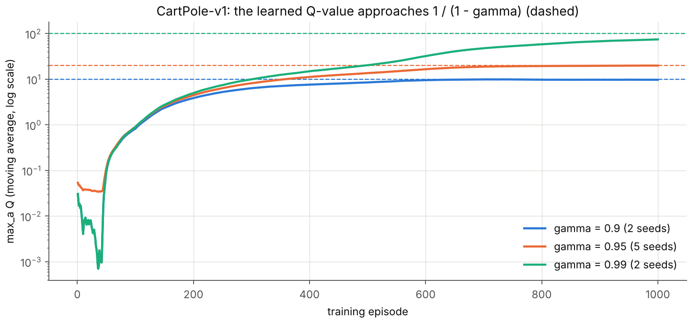{ width=78% }

{ width=78% }

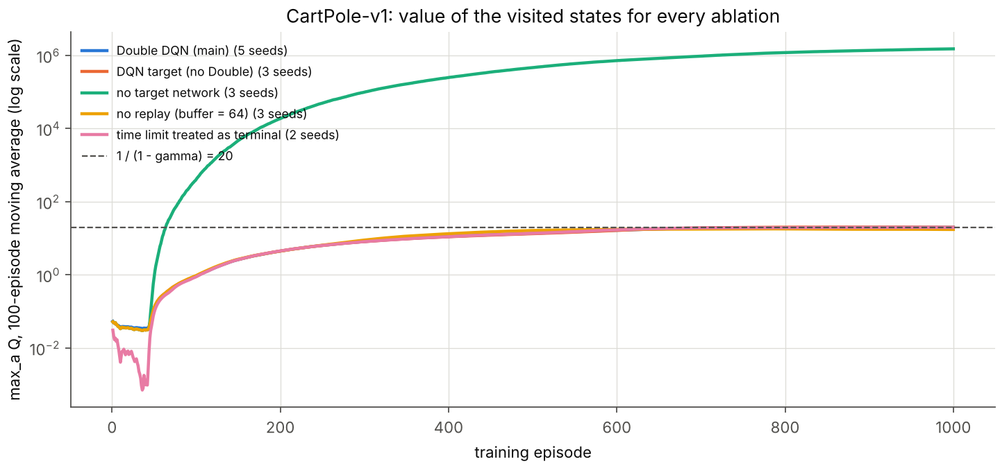{ width=78% }

## With three more months (part a)

- Repeat every configuration with 20 or more seeds and report confidence intervals for the probability that the kept network solves the task, for the episode at which it is found, and for the size of the collapse after it.
- Measure the action gap $Q(s, a_1) - Q(s, a_2)$ along training and test directly whether the collapses start when the gap falls below the noise of the updates, as argued above. Then test the remedies that act on it: prioritised replay of rare failure transitions, a replay buffer that keeps a fixed share of old episodes, a larger final $\epsilon$, a smaller final learning rate, and the advantage-learning operator that widens the gap.
- Compare the stopping or selection rule with the alternatives (fixed budget, stopping when the moving average reaches 475, selection on 100 instead of 20 evaluation episodes) by their false-positive rate on 500 fresh episodes.
- Test the learned policy beyond its training distribution: random initial states far from upright, pushes during the episode, changed pole length and mass, and the time limit raised to 5000 steps.
- Check $\gamma = 0.95$ against $\gamma = 0.99$ at equal compute: the longer horizon should remove the cart-position failures described in the edge cases.

# Part (b): MsPacman-v5

## Setup

`ALE/MsPacman-v5` runs with its defaults: frame skip 4, 9 actions, 3 lives and at most 108,000 frames per game. Sticky actions are on: with probability 0.25 the emulator repeats the previous action, whatever the agent chose. Every frame goes through the assignment's `preprocess_observation()` unchanged (88 x 80 pixels, int8). The state stacks the last 4 preprocessed frames, so it shows where Ms. Pac-Man and the ghosts move.

After a reset the stack holds four copies of the first frame.

The network divides its input by 128. It is the network of Mnih et al. (2015) (`--arch nature`). Its convolutions have 32 filters of 8x8 (stride 4), 64 of 4x4 (stride 2) and 64 of 3x3 (stride 1). A 512-unit layer and 9 outputs follow.

The discount factor is $\gamma = 0.99$, as prescribed. Adam starts at learning rate $10^{-4}$ and decays linearly towards $5 \times 10^{-5}$ over 5 million agent steps ($\epsilon_{\text{Adam}} = 1.5 \times 10^{-4}$). The loss is the Huber loss, with the gradient norm clipped at 10.

Each update uses a minibatch of 32 transitions, and one update follows every 4 agent steps. The target network is copied every 2,000 updates (8,000 agent steps). The replay buffer holds 500,000 frames, and updates start after 50,000 steps of random actions. $\epsilon$ then falls from 1 to 0.1 over 250,000 steps and reaches 0.01 at step 2.5 million.

Rewards are clipped to $[-1, 1]$ inside the Bellman target only. A lost life ends the bootstrap but not the game. Both rules are edge cases below.

**Runs.** Three seeds (0, 1 and 2) trained for 6,000 games each in one Nomad job on the lab node mlds-deepdish5 (`scripts/nomad/mspacman-dqn-gpu.nomad`). The three training processes shared one NVIDIA RTX PRO 5000 Blackwell GPU and 6 reserved CPU cores, with 1 PyTorch thread each. After training, each final network played 500 greedy test games with sticky actions on (environment seed 2026). All reported scores are raw scores of complete games.

## Results

**All three seeds learned to play, and their final networks average 1,503 to 2,314 points over 500 greedy test games.** A random policy averages 245 points (test P2).

Training of the three seeds (100-game moving average of the training score):

| seed | agent steps (frames) | updates | hours | average, first 100 games | average, last 100 games | highest average (at game) |
|----|----------------|------------|------|-----------|-----------|--------------|
| 0 | 4,569,170 (18.3 M) | 1,129,792 | 2.48 | 261 | 1,954 | 2,142 (5,682) |
| 1 | 4,707,150 (18.8 M) | 1,164,287 | 2.56 | 257 | 2,031 | 2,171 (5,702) |
| 2 | 4,341,878 (17.4 M) | 1,072,969 | 2.32 | 260 | 1,688 | 1,688 (6,000) |

500 greedy test games of each final network:

| seed | mean | standard deviation | standard error | median | minimum | maximum |
|----|--------|--------|--------|--------|--------|--------|
| 0 | 2,314.3 | 381.6 | 17.1 | 2,380 | 920 | 3,750 |
| 1 | 2,207.0 | 630.5 | 28.2 | 2,160 | 470 | 5,470 |
| 2 | 1,503.0 | 319.9 | 14.3 | 1,380 | 710 | 4,440 |

The mean of the three test means is 2,008.1. The DQN of Mnih et al. (2015) reports 2,311 points on Ms. Pac-Man after 200 million frames. Its evaluation protocol differs from this one (no sticky actions, $\epsilon = 0.05$, up to 30 no-op starts). Each run here saw 17.4 to 18.8 million frames.

**Learning.** At games 1,000, 2,000 and 3,000 the 100-game moving averages of the three seeds lay within 112 points of each other (Figure FIG(mspacman_compare_seeds)). After game 3,000 seed 2 fell behind: its average was 1,468 at game 5,000, against 1,854 and 1,888 for seeds 0 and 1. Over the last 1,000 games the averages still rose, by 100, 143 and 220 points. Games became longer as well: 495 to 505 agent steps on average over the first 100 games, 887 to 1,070 over the last 100.

Every 100 training games, the greedy policy played 10 evaluation games (Figure FIG(mspacman_eval_periodic)). Their highest averages are 2,245 (seed 0, game 5,500), 2,516 (seed 1, game 5,800) and 2,016 (seed 2, game 3,600). From game 3,700 on, the training policy takes a random action in only 1 % of the steps. The evaluation averages then lie close to the training average.

**(i) Maximum Q-values (Figure FIG(mspacman_cluster_seed0_maxq)).** The values are in clipped-reward units: $Q$ is the discounted number of rewarding steps before the next lost life. Over the last 100 games, $\max_a Q$ of the visited states averaged 13.15 to 13.40 across the seeds. The largest value in a game averaged 28.8 to 30.5 over the same games.

The average over 1,000 fixed held-out states, collected with a random policy before training, rose steadily to 15.80 to 17.33 at game 5,000. After game 5,000 it changed by -0.26 to +1.55 and ended at 16.14 to 18.01. These held-out states come from short random games, so most of their pellets are still uneaten. This likely explains their higher value (not checked state by state).

**(ii) Scores (Figure FIG(mspacman_cluster_seed0_training)).** Over the last 100 training games of the three seeds, single games scored 760 to 3,740. The sticky actions, the 1 % of random actions and the three lives cause this spread. The moving average and the greedy evaluation games are therefore the quantities to compare.

**(iii) Test games (Figure FIG(mspacman_cluster_seed0_hist)).** All 1,500 test games of the three final networks score above the best of 100 random games (410). Seed 0 leads seed 1 by 107 points, about 3.3 standard errors of the difference. Seed 2's games cluster tightly: 300 of its 500 games score 1,250 to 1,450, and 86 score exactly 1,380.

The same three figures for seeds 1 and 2 are in `results/mspacman/figures_cluster/`. `mspacman_diagnostics.png` there shows the loss, the Bellman error, the game length and the schedules.

**Two runs of the same seeds.** The same job first ran on mlds-deepdish4, which shared its RTX A6000 GPU with another process and used 2 threads per seed. Nomad deleted that finished job and its files before the results were copied. Only its logs up to games 5,105 to 5,168 survive (`results/mspacman/gpu_run1_partial`).

The two runs produced identical scores for the first 101, 121 and 107 games of seeds 0, 1 and 2. Updates began during games 100 to 102, and the runs diverged soon after. The likely cause is rounding that differs between the two GPU models (not tested).

At game 5,000 the 100-game averages were 1,912, 1,741 and 1,754 on deepdish4, against 1,854, 1,888 and 1,468 on deepdish5. Seed 2 scored like the other seeds on deepdish4. Its lower result on deepdish5 is therefore within the variation between two runs of one seed.

**Earlier cloud CPU runs.** Before the cluster was available, seeds 0 and 1 trained on a cloud machine with 4 CPU cores and no GPU (`results/mspacman/main_seed*`, `cont_seed*`). They used the same code with five settings shortened for that budget: the Mnih et al. (2013) network, updates from step 20,000, $\epsilon = 0.01$ from step 1.5 million, learning-rate decay over 3 million steps, and target copies every 1,000 updates. Machine restarts stopped them after 2,150 games (seed 0) and 1,250 games (seed 1). Their best network, seed 0 after game 1,500, averaged 1,074.9 over 500 greedy test games.

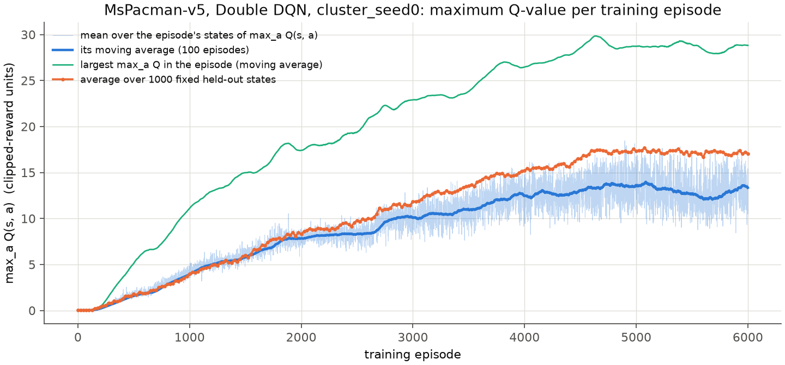{ width=78% }

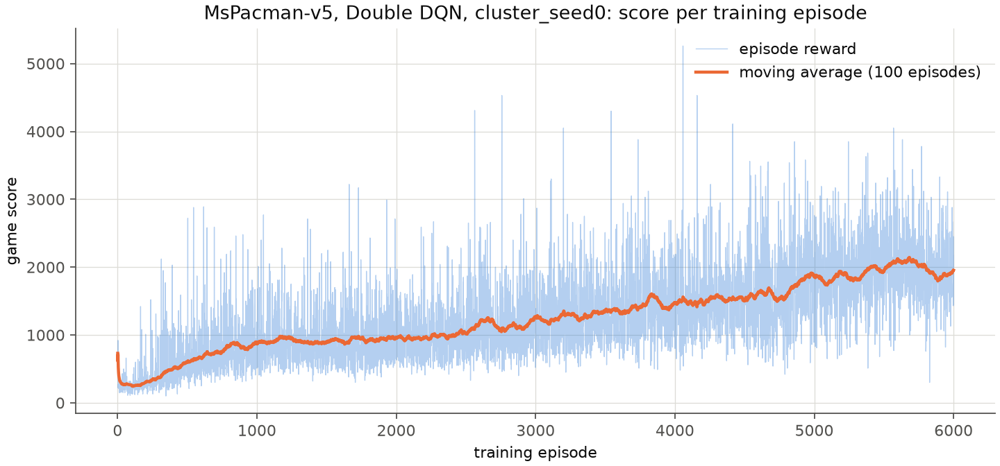{ width=78% }

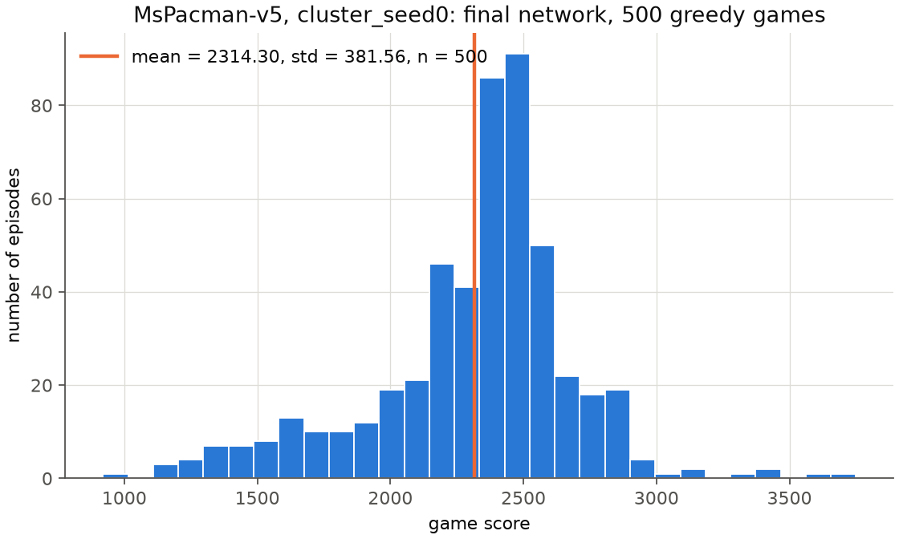{ width=62% }

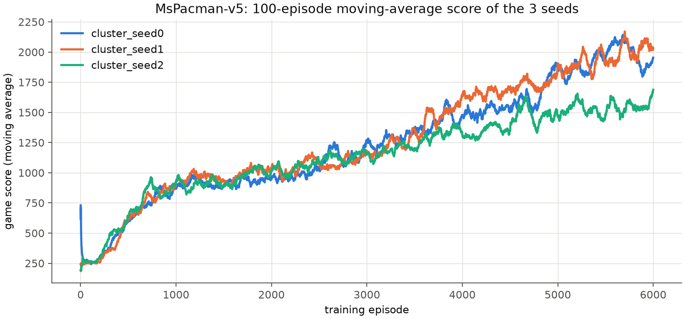{ width=78% }

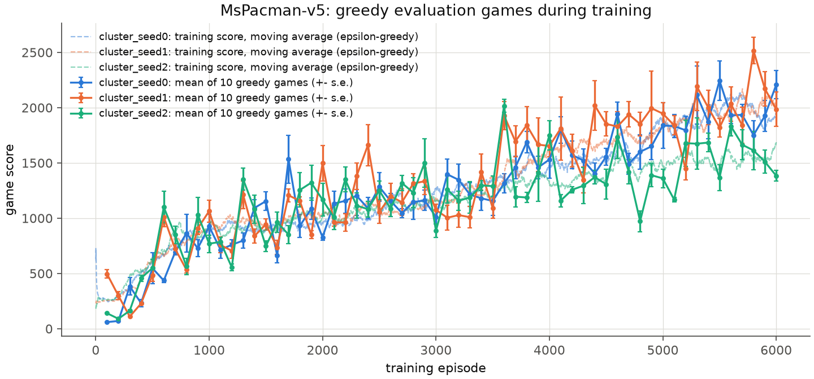{ width=78% }

## Edge cases (part b)

- **The given preprocessing function computes in unsigned integers.** The observation is `uint8`, so `img.sum(axis=2)` is `uint64`, and `img // 3 - 128` wraps around for every pixel darker than 128. The final `astype(np.int8)` keeps the lowest 8 bits, which equal the intended signed value. The function is used unchanged, and a unit test finds it identical to a signed computation on a random frame. In a real game its output lies in $[-128, 27]$, so the network input $x/128$ lies in $[-1, 0.21]$.
- **The contrast trick must hit Ms. Pac-Man and nothing else.** Pixels whose colour channels sum to 448 are set to the darkest value. In each of 449 frames of a random game, 7 to 17 pixels of the cropped frame had this sum (test P1, Figure FIG(fig_val_preprocess)). No pixel of any other colour had it, so only Ms. Pac-Man is darkened and she is always visible in the input.
- **One frame shows no motion, and a state must not mix two games.** The replay buffer stores every frame once (500,000 frames, 3.5 GB) and rebuilds the 4-frame stacks at sampling time. A frame from the previous game is replaced by the first frame of the current one, as in the acting loop. Once the buffer is full, the 4 oldest slots are never sampled, because their stacks would reach into the newest frames. A unit test replays 60 random-length episodes through buffers of 37, 50 and 1,000 slots and checks every transition the buffer can return.
- **Lives.** A lost life ends the bootstrap: the target is the clipped reward alone. The game, the frame stack and the reported score continue. The crop removes the bottom of the screen, where the remaining lives are drawn. The network therefore cannot see how many lives are left (checked at the three life losses of a game).
- **Sticky actions.** The stored action is the one the agent chose, because the update concerns the value of that choice. The repetition by the emulator is part of the transition noise. Test P7 switches it off to make the game deterministic.
- **Reward scale.** A pellet is worth 10 points, a power pellet 50, a ghost 200 to 1,600 and a fruit 100 to 5,000. The target clips rewards to $[-1, 1]$, so $Q$ is at most $1/(1-\gamma) = 100$ and the maximum-Q plot is in these units. As a result a ghost is worth as much as a pellet; test P9 measures what the agent eats.
- **The time limit.** A game is truncated after 108,000 frames (27,000 agent steps), and the truncation is bootstrapped as in CartPole. No game reached it: the longest of the 18,000 training games had 2,095 agent steps.
- **A greedy policy can get stuck.** An early greedy policy can repeat one losing route whatever the sticky actions do. Five evaluations gave one score in all 10 games: games 100 and 200 of seeds 0 and 2, and game 300 of seed 1. Test P8 shows the route of seed 0's network of game 250: Ms. Pac-Man moves right along one corridor and stays at its end. No later evaluation of any seed gave one score in all 10 games.
- **Cluster jobs and their files disappear after they end.** On this cluster Nomad removed the finished deepdish4 job, its allocation and its files within about 6 hours. The job script (`scripts/nomad/run.sh`) now keeps the task alive after the test games until the file `/alloc/data/FETCHED` exists, for at most 12 hours. The results were also copied to a laptop every 2 hours during the run.
- **Interruptions.** Every run writes a checkpoint every 50 games and network snapshots at fixed games. The replay buffer (3.5 GB) is not part of the checkpoint, so a resumed run refills it for 50,000 steps before updating again. The deepdish5 runs did not need a resume.

## Tests that validate correctness (part b)

`python -m dqn.validate_mspacman --run results/mspacman/cluster_seed0 --out results/mspacman/validation_cluster_seed0` runs P1 to P9 on a trained network. The results of the three seeds are in `results/mspacman/validation_cluster_seed*/validation.md`. The numbers below are for seed 0 unless a seed is named.

1. **P1: preprocessing (Figure FIG(fig_val_preprocess)).** The figure shows the raw frame, the preprocessed frame and the four frames of a state. The colour sum 448 marks Ms. Pac-Man and nothing else: 7 to 17 pixels in each of 449 frames, and no pixel of another colour. The output range in a game is $[-128, 27]$. A unit test confirms the unsigned arithmetic.
2. **P2: random policy.** 100 games with uniformly random actions score 245.1 on average (standard deviation 50.4, minimum 140, maximum 410). They last 495 agent steps on average. The learning curves and test scores above are compared with these numbers.
3. **P3: learning without exploration noise (Figure FIG(fig_val_snapshots)).** Every saved network played 20 greedy games with sticky actions on and new seeds. The mean scores are 210, 60, 594 and 718 for the networks of games 0, 250, 500 and 1,000. They are 929, 1,293, 1,385, 1,929 and 2,111 at games 2,000 to 6,000. The final networks of seeds 0, 1 and 2 score 2,111, 2,287 and 1,592 here, close to their 500-game test means.

   Seed 0's networks of games 0, 100 and 250 score 210, 60 and 60 in all 20 games. Seed 2's networks of the same games score 140, 140 and 110 in all 20 games. This is the stuck greedy policy described in the edge cases.
4. **P4: does the network predict what it is trained to predict? (Figure FIG(fig_val_calibration))** The network is trained to predict the discounted sum of clipped rewards up to the next lost life. Along 20 greedy games (19,484 steps), the predicted $Q(s_t, a_t)$ averages 12.46 and the realised return of the same policy 12.25. Prediction and outcome have correlation 0.75. For seeds 1 and 2 the average overestimation is 2.44 and 1.89, with correlations 0.69 and 0.64.

   In 20 bins of the prediction, every bin from 5.7 upwards has a mean realised return 0.4 to 3.3 below its prediction. The bin at prediction 1.98 has a mean realised return of 17.27. In the figure these states form a vertical band at prediction 2, with realised returns of about 12 to 28. They match the frozen game starts of P7 (not checked state by state).
5. **P5: value around game events, the non-standard plot (Figure FIG(fig_val_events)).** For every event in 20 greedy games, the trace of $\max_a Q$ is aligned on the event and averaged. Around a lost life (n = 40) it averages 10.30 at 60 steps before, 3.96 at 10 steps before and 2.62 at the event. Most of the fall happens between 20 and 16 steps before the event. After the event the value stays at 4.43 during the frozen restart of the next life.

   Around a power pellet (n = 77) the value rises from 17.56 sixty steps before to 23.38 ten steps before. The rise comes in two jumps, about 45 and 41 steps before the pellet (cause not examined). Seed 2 shows the same rise (18.36 to 22.43), and seed 1 does not (16.35 to 16.42). The cloud network after 1,100 games showed no rise either (7.92 to 7.81).

   Around an eaten ghost (n = 44) the value falls from 20.35 sixty steps before to 16.90 at the event. The value at the event lies within 0.5 of its level ten steps before and ten steps after (17.34 and 17.33).
6. **P6: the first 10 steps of a greedy game.** The table follows the final network from the start of a game. During these steps the game is still in its frozen intro (test P7): no action has any effect and the reward is 0. The Bellman target is therefore $0.99 \max_a Q(s')$. The action gap stays below 0.09, and the greedy action switches between UPRIGHT, DOWN and LEFT.

| t | lives | Ms. Pac-Man (row, col) | max Q | argmax | max Q - min Q | action | reward | y = clip(r) + 0.99 max Q(s') |
|--|---|------|----|--------|-----|--------|----|--------|
| 0 | 3 | (103, 80) | 1.774 | UPRIGHT | 0.0697 | UPRIGHT | 0 | 1.781 |
| 1 | 3 | (103, 79) | 1.799 | UPRIGHT | 0.0791 | UPRIGHT | 0 | 1.874 |
| 2 | 3 | (103, 80) | 1.893 | UPRIGHT | 0.0802 | UPRIGHT | 0 | 1.816 |
| 3 | 3 | (103, 80) | 1.834 | DOWN | 0.0880 | DOWN | 0 | 1.761 |
| 4 | 3 | (103, 80) | 1.779 | LEFT | 0.0732 | LEFT | 0 | 1.903 |
| 5 | 3 | (103, 79) | 1.923 | DOWN | 0.0654 | DOWN | 0 | 1.953 |
| 6 | 3 | (103, 80) | 1.973 | DOWN | 0.0688 | DOWN | 0 | 1.908 |
| 7 | 3 | (103, 80) | 1.927 | LEFT | 0.0738 | LEFT | 0 | 1.807 |
| 8 | 3 | (103, 80) | 1.825 | LEFT | 0.0589 | LEFT | 0 | 1.870 |
| 9 | 3 | (103, 79) | 1.889 | LEFT | 0.0818 | LEFT | 0 | 1.964 |

7. **P7: determinism and the frozen start.** With sticky actions switched off, the emulator and the greedy policy are both deterministic, so games started with different seeds must be identical. The five games all scored 2,490 and lasted 1,239 steps. With the default sticky actions, the same five seeds gave 1,480, 1,880, 1,840, 2,070 and 2,450. Seeds 1 and 2 also gave five identical games each (2,330 and 1,370 points).

   At each of the first 120 steps of a game, the emulator was cloned and all 9 actions were applied. In the first 66 steps every action led to exactly the same emulator state; this is the intro of the game. There the action gap $\max_a Q - \min_a Q$ averages 0.076, against 0.682 afterwards.

   During the intro only the first reward comes closer, so $\log \max_a Q$ should grow by $-\log 0.99 = 0.0101$ per step. The fitted slope over the 66 frozen steps is 0.0008 ($\max_a Q$ from 1.77 to 2.13), and seeds 1 and 2 give 0.0005. The network therefore does not track the value in the intro, and P4 shows that it underestimates these states. No action matters there, so this error cannot change a decision; its cause was not tested.
8. **P8: where Ms. Pac-Man goes, a second non-standard plot (Figure FIG(fig_val_positions)).** Ms. Pac-Man's position was read from her colour in the raw frames of 10 greedy games per network. The network of game 250 visited 0.8 % of the 4 x 4-pixel cells of the screen (4,650 positions). It moved right along one corridor and stayed at its end in every game. The final network visited 24.6 % of the cells (10,142 positions), covering most corridors of the maze.

   Seeds 1 and 2 visited 3.2 % and 3.0 % of the cells at game 250. Their final networks visited 24.7 % and 23.1 %.
9. **P9: what the agent eats.** Over 20 greedy games the final network scores 2,242 per game. Rewards of 100 points or more (ghosts and fruit) make up 29.9 % of it. It eats 3.85 power pellets per game (the first maze has 4) and 2.2 ghosts. The random policy scores 272.5 per game, 3.7 % of it from such rewards, with 0.10 power pellets and 0.05 ghosts.

   Seed 2 eats 2.2 power pellets and 0.4 ghosts per game. Its pellets bring 1,259 points per game, against 1,380 for seed 0. Ghosts and fruit bring it 106 points per game, against 670 for seed 0. They therefore account for 564 of the 768-point gap between the two seeds (1,474 against 2,242 per game).

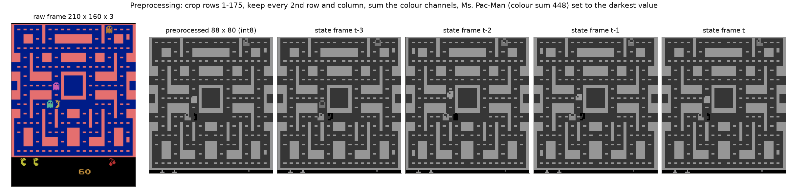{ width=100% }

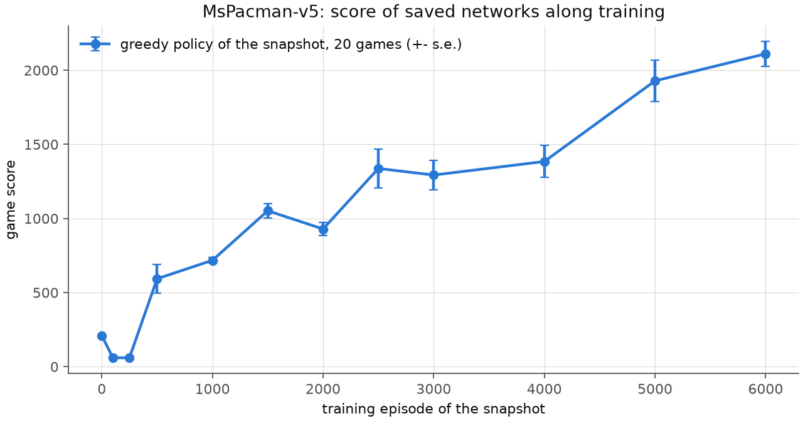{ width=66% }

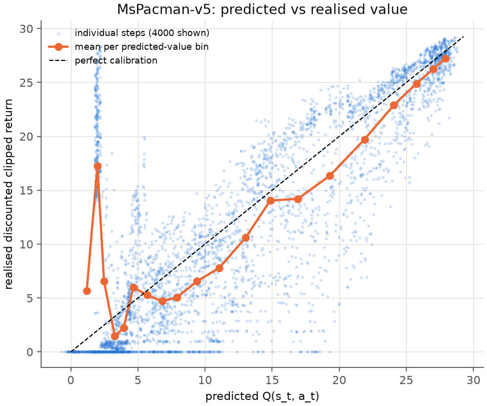{ width=52% }

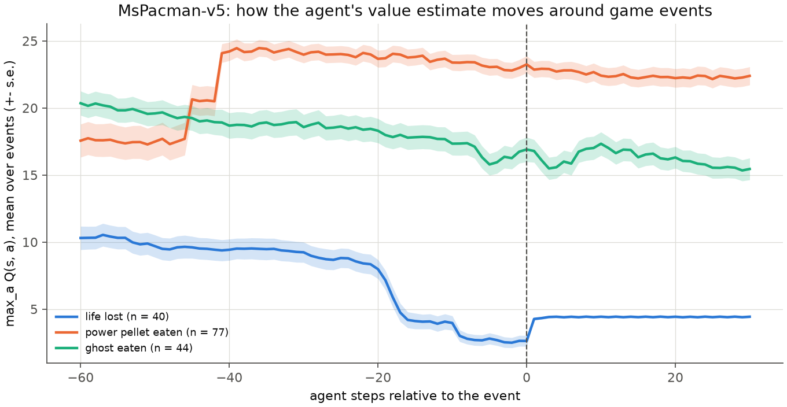{ width=72% }

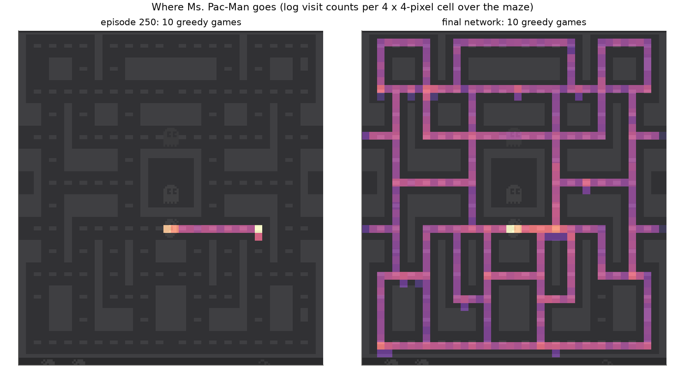{ width=80% }

## With three more months (part b)

- Train 10 or more seeds for 6,000 games, and run each seed at least twice. For one seed, the two runs here differ by up to 286 points of the 100-game average at game 5,000. Report the learning curves with confidence bands for seeds and for repeated runs.
- Train longer: all three 100-game averages still rose over the last 1,000 games. The DQN results of Mnih et al. (2015) use 200 million frames, about 11 times the 17.4 to 18.8 million used here.
- Ablate each design choice on MsPacman at equal compute. The comparisons are clipped against log-scaled or Pop-Art normalised rewards, life loss as terminal or not, Double against plain DQN, and the two networks. Clipping makes a ghost worth as much as a pellet, and seed 2 eats 0.4 ghosts per game.
- Add the standard improvements one at a time (prioritised replay, dueling network, n-step returns, noisy networks) and measure their effect on the same seeds.
- Find why the network underestimates the frozen game start (predictions near 2 against realised returns of 12 to 28). Compare $Q$ with Monte Carlo returns from many roll-outs of cloned emulator states. Each state's error is then measured without the noise of a single game.
- Probe what the network has learned with saliency maps and with controlled states (a ghost next to Ms. Pac-Man, a power pellet just eaten). Measure the score under other sticky-action probabilities, frame skips and the other mazes of the game.
