# Repository and how to run the code

Özgün Barış Kır (3676663). GitHub username: **ozgunbaris**. Repository: **mlds-rl-assignment2**, <https://github.com/ozgunbaris/mlds-rl-assignment2>.

All code is in the repository and `README.md` lists every command. Short version (Python 3.12, run from the repository root):

```bash
python3.12 -m venv .venv && source .venv/bin/activate
pip install -r requirements.txt
python -m pytest tests -q                                       # 11 mechanical checks
python -m dqn.cartpole_dqn --out results/cartpole/main_seed0 --seed 0 \
    --episodes 1000 --eps-final 0.1 --no-stop-when-solved \
    --eval-periodic-episodes 20                                 # (a), one seed
scripts/run_cartpole.sh                                         # (a), all 24 runs
python -m dqn.make_plots_cartpole                               # (a) figures
python -m dqn.validate_cartpole                                 # (a) validation
scripts/run_mspacman.sh                                         # (b) training + 500 games
python -m dqn.make_plots_mspacman --runs results/mspacman/main_seed0
python -m dqn.validate_mspacman --run results/mspacman/main_seed0
```

Every `results/*` folder holds the logs (`episodes.csv`, `heldout_q.csv`, `eval_periodic.csv`), the network weights, the roll-out rewards (`eval_rewards_*.npy`, `eval_summary_*.json`), the figures, and `validation.md` with the numbers quoted below.

**Compute.** All runs were made on a cloud machine with 4 CPU cores and no GPU, inside a fixed time window of about three hours. MsPacman therefore trained for a fixed wall-clock budget of 1.7 hours on 3 CPU threads (one run), while the 4th core ran the 24 CartPole runs one after another. The consequences for MsPacman are discussed in its section.

# The DQN implementation (shared by both games)

`dqn/core.py`, `dqn/replay.py` and `dqn/networks.py` are shared. One training step does the following.

1. Act $\epsilon$-greedily on the online network $Q_\theta$: a uniformly random action with probability $\epsilon$, otherwise $\arg\max_a Q_\theta(s, a)$. The exploration rate follows a piecewise-linear schedule (an $\epsilon$ scheduler).
2. Store the transition $(s, a, r, s', d)$ in the **replay buffer**. $d$ is the bootstrap mask: it is 1 only when the episode really ended (pole fell, cart left the track, game over, or a lost life in MsPacman). A time-limit truncation is not terminal: $s'$ is a real state and its value is bootstrapped (edge cases below).
3. Sample a uniform minibatch from the buffer and form the **Double DQN** target with the **target network** $Q_{\bar\theta}$:
$$y = r + \gamma\,(1 - d)\,Q_{\bar\theta}\big(s', \arg\max_{a'} Q_\theta(s', a')\big).$$
The online network chooses the next action and the target network evaluates it, which removes most of the upward bias of $\max_{a'} Q_{\bar\theta}(s', a')$ (van Hasselt et al. 2016). `--no-double` gives the original DQN target.
4. Take one Adam step on the **Huber loss** between $Q_\theta(s, a)$ and $y$ ($y$ carries no gradient), with the gradient norm clipped at 10. The learning rate decays linearly (a learning-rate scheduler).
5. Copy $\theta$ into $\bar\theta$ every fixed number of updates.

The three required components are therefore a neural network ($Q_\theta$), a replay buffer (`VectorReplay`, `FrameStackReplay`) and a target network ($Q_{\bar\theta}$). Ablations that remove each of them are reported in part (a).

**Maximum Q-value plots.** For plot (i) every training episode logs, from the forward passes the agent already makes to act, the mean over the states it visited of $\max_a Q_\theta(s, a)$, the largest such value in the episode and the value of the first state. Each run also tracks the average of $\max_a Q_\theta$ over a fixed set of held-out states collected with a random policy before training (Mnih et al. 2015, Fig. 2), which does not move with the agent's own state distribution.

# Part (a): CartPole-v1

## Setup

The Q-network is a 4-128-128-2 MLP with ReLU. Its inputs are divided by $(2.4, 3, 0.21, 3.5)$, the cart-position and pole-angle failure limits and typical velocities, so that all four are of order 1. Discount factor $\gamma = 0.95$ as prescribed. Adam with learning rate $5 \times 10^{-4}$ decaying linearly to $5 \times 10^{-5}$ over the 1000 training episodes; minibatch 64; replay buffer of 50,000 transitions; updates start after 1000 steps; one update per environment step; the target network is refreshed every 500 updates. $\epsilon$ decays linearly from 1 to 0.1 between steps 1,000 and 21,000 and stays at 0.1.

Every 25 training episodes the greedy policy plays 20 evaluation episodes on a separate environment instance. The network with the best such score (ties go to the later network) is kept as the trained model; the reasons for this choice and the behaviour of the network after the last episode are part of the edge cases. After training, 500 new greedy episodes (new seeds) are rolled out with the kept network and with the final network. Five seeds were run.

## Results

**The task is solved.** The kept networks of three of the five seeds balance the pole for all 500 steps in every one of the 500 roll-out episodes (mean 500.0, standard deviation 0.0); the other two reach 500 steps in 97.8 % and 85.2 % of the episodes. In the five main runs every roll-out failure, of the kept and of the final networks, is the cart leaving the track; the pole never fell.

| seed | kept network: training episode (epsilon) | its 500 greedy roll-outs: mean (std) | share at 500 steps | network after the last episode: mean | training MA100 at the end |
|---|---|---|---|---|---|
| 0 | 950 (0.10) | 500.0 (0.0) | 100 % | 173.4 | 125.3 |
| 1 | 550 (0.31) | 495.4 (33.6) | 97.8 % | 98.0 | 85.7 |
| 2 | 275 (0.71) | 455.8 (106.0) | 85.2 % | 88.6 | 89.5 |
| 3 | 800 (0.10) | 500.0 (0.0) | 100 % | 103.9 | 88.3 |
| 4 | 175 (0.86) | 500.0 (0.0) | 100 % | 98.3 | 101.4 |

Mean over the five seeds of the kept networks' roll-out means: 490.2. One run (1000 episodes, 53,000 to 68,000 steps) takes 83 to 114 seconds on one CPU core. The figures below are those of seed 0, whose network was kept late in training (episode 950), so that its Q-values are also converged; the corresponding figures of all seeds are in `results/cartpole/figures/per_run/`.

**(i) Maximum Q-values.** The value of the visited states rises from 0 to the bound $1/(1-\gamma) = 20$ in about 600 episodes and stays there (mean of the last 100 episodes 19.72; 19.78 to 20.37 over the seeds). Every step pays $+1$ and the time limit is bootstrapped, so a policy that never fails has $Q = 20$ exactly; the learned value approaches this number from below. The average over the 500 fixed held-out states (taken from a random policy, so they include falling poles) settles lower, at 18.1. The held-out curve rises in steps: each step is a copy of the online network into the target network (every 500 updates), the moment when the regression target moves.

**(ii) Rewards.** The training reward is collected with $\epsilon$-greedy actions, and after step 21,000 one action in ten is random. In states where the margin is small one random push ends the episode (the trace in the tests shows a state where the wrong action is worth 6.3 against 20.7, i.e. failure within about 7 steps), so the 100-episode moving average stays near 100 even when the greedy policy is perfect. The green markers in the same figure are the greedy checks (20 separate evaluation episodes every 25 training episodes): they reach 500 already at episode 125 (seed 0; 125 to 225 for four seeds), when $\epsilon$ is still about 0.9, and fluctuate between about 100 and 500 once $\epsilon$ is at its floor. This instability is analysed in the edge cases.

**(iii) Roll-outs.** The kept network of seed 0 scores 500 in all 500 greedy episodes.

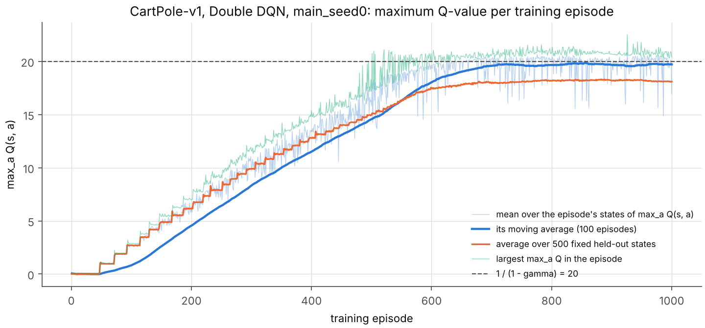{ width=78% }

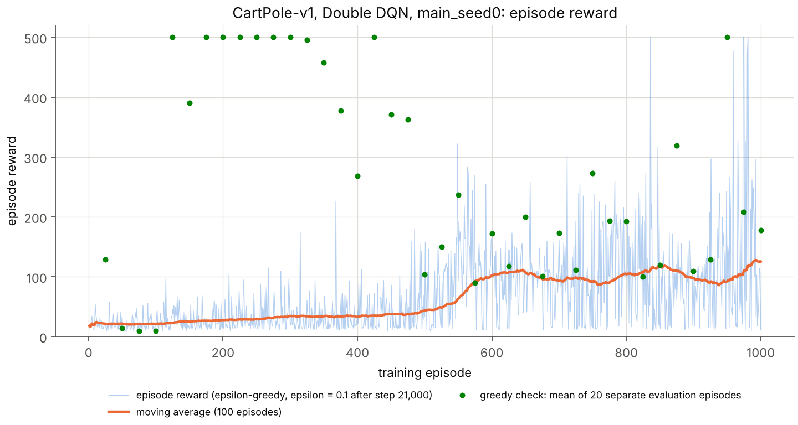{ width=78% }

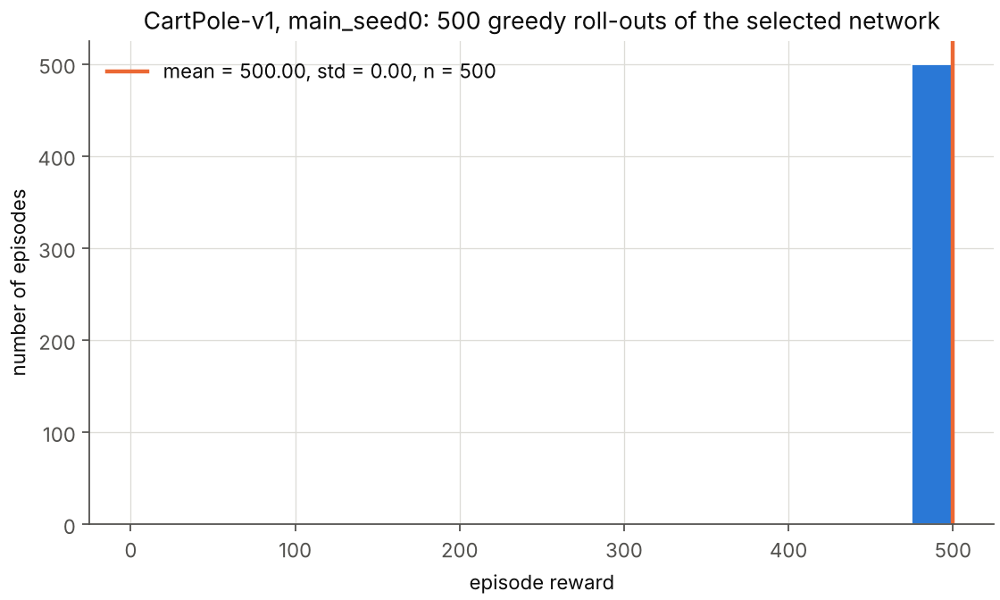{ width=62% }

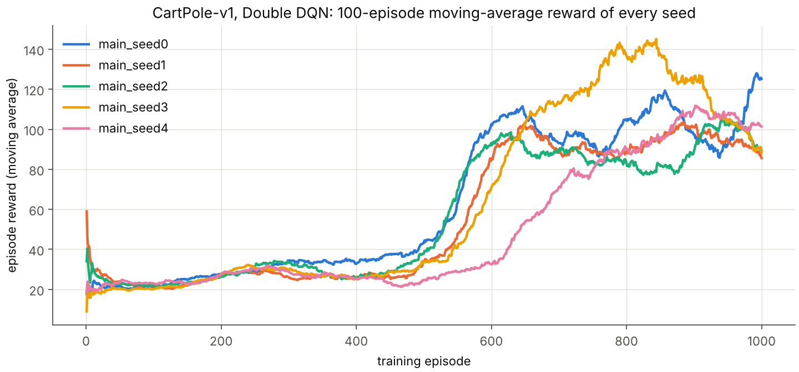{ width=78% }

## Edge cases (part a)

- **The 500-step time limit is a truncation, not a terminal state.** CartPole-v1 returns `truncated = True` after 500 steps. The state (cart position and velocity, pole angle and angular velocity) carries no clock, so the value of a state cannot depend on how many steps happen to remain. The bootstrap mask is therefore $d = $ `terminated` only, and the target at a truncated step is $1 + \gamma \max Q(s')$, not 1. Treating the limit as terminal gives some visits of a state the target 1 and the others about 20. Test C1 measures the resulting bias on a problem where it can be computed exactly, and the `truncterm` runs measure its effect on CartPole (tests below).
- **The reward of the last step and the bound on Q.** CartPole pays $+1$ on every step, including the step on which the pole falls, so the target of a terminal transition is exactly 1 and every $Q$ lies in $[1, 1/(1-\gamma)] = [1, 20]$. The learned values respect this on the states the agent visits (19.72 at the end of seed 0); predictions above 20 are overestimation and are measured in test C3.
- **A discount factor of 0.95 makes the agent short-sighted, and the cart drifts off the track.** A failure $T$ steps ahead lowers the value by $20 \cdot 0.95^T$: by 7.2 at $T = 20$, 0.92 at $T = 60$ and 0.12 at $T = 100$. A slow drift of the cart toward the edge is therefore almost invisible to the value until it can no longer be corrected. The first trial network (600 episodes, $\epsilon$ floor 0.02, unscaled inputs; `results/cartpole/preliminary/cp_try0`) balanced the pole but lost the cart in all 500 roll-outs, after 115 steps on average, and in the five main runs every roll-out failure is a cart-position failure. The cart-position map of the kept network (Figure FIG(fig_val_position_map_main)) shows the cause: with the pole upright, the value falls to about 18 only at the left edge while moving left; the right edge is barely represented, and in states the agent never visits (fast motion near an edge) the network extrapolates up to 23.3, above the bound. Scaling the four inputs to order 1, training longer and keeping more exploration (next item) are the remedies that made the kept networks hold the cart on the track for 500 steps.
- **Instability once the task is learned, and how the trained network is chosen.** Once the agent balances, almost every target is close to 20 and the two actions differ by very little: the median absolute action gap $|Q(s,\text{right}) - Q(s,\text{left})|$ on visited states is 0.044 (test C5). A small change of the weights then flips the greedy action in many states, so the greedy policy keeps changing even when the loss is small. The greedy checks show it (Figure FIG(cartpole_main_seed0_training)): repeatedly perfect between episodes 125 and 425, then between about 100 and 500 once $\epsilon$ reached its floor (episode 558). All five networks after the last episode score 88.6 to 173.4. The preliminary runs (`results/cartpole/preliminary/README.md`) show the same with every variation tried (larger buffer and batch, soft target updates, a wider network, a stopping rule). The remedy used here is model selection on separate data: the network with the best greedy check (20 evaluation episodes on a different environment instance) is kept, and it is judged on 500 new episodes. Both networks are reported.
- **Exploration keeps the data informative.** The perfect greedy policies appear early, when $\epsilon$ is still large and the replay buffer is full of near-failures: in the preliminary runs with a stopping rule active from the start, four of four seeds stopped at episodes 125 to 250 ($\epsilon$ 0.75 to 0.91) with Q-values of only 3.4 to 8.9 and scored 500 in all 500 roll-outs. The greedy policy only needs the sign of the action gap, not the value. With an $\epsilon$ floor of 0.02 the stopped networks were worse (97.4 % to 99.0 % at 500 steps, one seed never stopped); with a floor of 0.1 the best-check networks of four of four seeds were perfect. The final configuration therefore keeps $\epsilon = 0.1$.
- **Warm-up of the replay buffer.** No update is made before 1000 transitions are stored, so the first minibatches are not dominated by a handful of correlated transitions; the buffer of 50,000 transitions holds the last 100 to 2,000 episodes, depending on their length.
- **Seeds.** DQN on CartPole varies a lot between seeds (kept networks 455.8 to 500.0), so every configuration was run with 5 seeds (main) or 2 to 3 seeds (ablations), and all of them are reported.

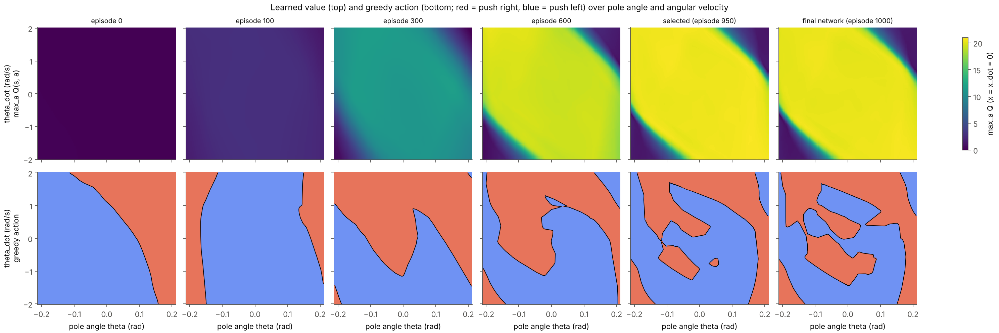{ width=100% }

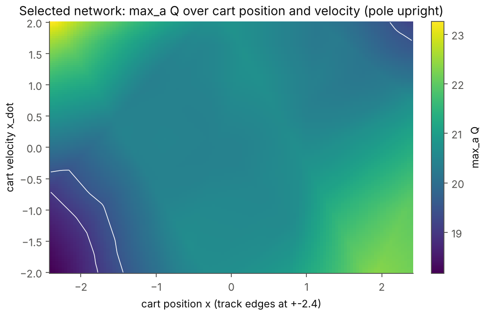{ width=58% }

## Tests that validate correctness (part a)

The 11 checks in `tests/test_dqn.py` cover the mechanics (the frame-stack replay buffer reproduces every stored transition across episode boundaries and wrap-around, the Bellman target masks terminal steps, Double DQN evaluates the online argmax with the target network, the target network stays frozen between copies, rewards are clipped only inside the target, the preprocessing matches a signed computation) and are not repeated here. The experiments below test whether the *algorithm* behaves as reinforcement learning predicts. `python -m dqn.validate_cartpole` runs them (test C7 summarises the ablation runs of `scripts/run_cartpole.sh`) and writes `results/cartpole/validation/validation.md`.

1. **C1: a deterministic problem with known answers (Figure FIG(fig_val_chain)).** `dqn/toy_chain.py` is an 8-state chain, observed as one-hot vectors, with deterministic left/right moves; moving into the last state pays 1 and ends the episode. Its exact $Q^*$ follows from value iteration. The same network class, replay buffer, Double DQN update and target network as for CartPole were trained for 20,000 steps from a uniformly random behaviour policy. The largest error $\max_{s,a} |Q - Q^*|$ was 0.0017, 0.0000 and 0.0000 for Double DQN (3 seeds), 0.0044, 0.0000, 0.0000 for the DQN target, and 0.0217, 0.0046, 0.0093 without a target network; the greedy policy was optimal in all 9 runs.
2. **C1: the time-limit edge case, with predicted numbers.** In a second chain every step pays 1, nothing terminates, and episodes are cut after 50 steps. Bootstrapping at the cut must give $Q = 1/(1-\gamma) = 20$ everywhere: measured 20.02, 20.01 and 19.99. If the cut is wrongly treated as terminal, a fraction $p = 1/50$ of the targets is 1 instead of $1 + \gamma Q$. With a squared loss the fixed point is the mean target, $Q = 1/(1 - \gamma(1-p)) = 14.49$: measured «C1_MSE». With the Huber loss the wrong targets lie far below $Q$, so each contributes a gradient of fixed size 1 instead of one proportional to its error; the fixed point solves $(1-p)(1 + \gamma Q - Q) = p$, i.e. $Q = (1 - p/(1-p))/(1-\gamma) = 19.59$: measured 19.43, 19.87, 19.66. The prediction was made before the measurement for the squared loss (14.49), and the Huber number was derived after the first measurement disagreed with it; both now agree with the theory. The Huber loss therefore makes the implementation robust to rare wrong targets, which is a second reason to use it besides the bounded gradient.
3. **The time limit in CartPole itself.** With $\epsilon = 0.1$ the $\epsilon$-greedy training episodes rarely survive 500 steps: the limit was reached in 4, 0, 0, 1 and 0 of the 1000 training episodes of the five seeds. Until the first truncation the `truncterm` runs (time limit treated as terminal) are the same computation as the main runs; seed 1 is identical to the last digit (kept network 495.4, final 98.0), and seed 0 departs only after episode 836 (kept 500.0 in both; final network 470.6 against 173.4, a divergence of two chaotic training runs rather than an effect of the time limit, since only 4 truncated transitions entered the buffer). On CartPole with this configuration the edge case exists in principle but almost never occurs, and C1 is the test that isolates it.
4. **C2: the scale of Q follows the discount factor and the reward.** «C2»
5. **C3: overestimation against the true return.** The kept network of seed 0 played 20 greedy episodes with the time limit raised to 2000 steps; all 20 lasted the full 2000 steps, four times the training limit, so the true discounted return of every state in the first 500 steps is 20.00 (the tail beyond 2000 steps is below $10^{-30}$). The predicted $Q(s_t, a_t)$ averaged 20.67: Double DQN still overestimates, by 0.67 (3.4 %), and by at most 1.05 in any state.
6. **C4: the first 10 steps of a greedy episode.** The table follows seed 0's kept network. While the pole is nearly upright the two actions are almost equally good (20.43 against 20.41 at $t = 0$), and the Bellman error $y - Q(s, a)$ is below 0.04 in absolute value in the first five steps (at most 0.22 in the ten). At $t = 6$ the pole leans right ($\theta = 0.103$) and rotates right ($\dot\theta = 1.23$): pushing left is worth 6.32, which is the value of failing in about 7 steps ($\sum_{k<7} 0.95^k = 6.0$), and pushing right 20.74, so the agent pushes right and keeps pushing right until the rotation slows (Q(left) recovers to 8.70, 12.64, 17.64).

| t | x | x_dot | theta | theta_dot | Q(left) | Q(right) | action | r | y = r + g max Q(s') | y - Q(s,a) |
|---|---|---|---|---|---|---|---|---|---|---|
| 0 | +0.013 | +0.040 | +0.028 | -0.027 | 20.434 | 20.406 | left | 1 | 20.432 | -0.0022 |
| 1 | +0.013 | -0.156 | +0.027 | +0.274 | 20.455 | 20.453 | left | 1 | 20.441 | -0.0135 |
| 2 | +0.010 | -0.351 | +0.032 | +0.575 | 20.465 | 20.420 | left | 1 | 20.427 | -0.0380 |
| 3 | +0.003 | -0.547 | +0.044 | +0.878 | 20.449 | 20.410 | left | 1 | 20.423 | -0.0265 |
| 4 | -0.008 | -0.743 | +0.062 | +1.184 | 19.906 | 20.445 | right | 1 | 20.454 | +0.0087 |
| 5 | -0.023 | -0.548 | +0.085 | +0.911 | 20.477 | 20.412 | left | 1 | 20.698 | +0.2210 |
| 6 | -0.034 | -0.744 | +0.103 | +1.229 | 6.321 | 20.735 | right | 1 | 20.631 | -0.1039 |
| 7 | -0.048 | -0.551 | +0.128 | +0.971 | 8.700 | 20.665 | right | 1 | 20.568 | -0.0968 |
| 8 | -0.059 | -0.358 | +0.147 | +0.721 | 12.637 | 20.598 | right | 1 | 20.578 | -0.0194 |
| 9 | -0.067 | -0.165 | +0.162 | +0.478 | 17.644 | 20.609 | right | 1 | 20.563 | -0.0459 |

7. **C5: mirror symmetry.** The dynamics are unchanged when every state variable changes sign and left and right are swapped, so a correct Q-function satisfies $Q(s, \text{left}) = Q(-s, \text{right})$. On 5000 states visited by the kept network the mean absolute difference is 0.29 and the action gaps of $s$ and $-s$ have correlation 0.970. The greedy actions agree in 66 % of the states, but this is concentrated where the actions are interchangeable: the agreement is 81.9 % where the gap exceeds 0.1 (32 % of the states), 88.6 % where it exceeds 0.5 and 95.4 % where it exceeds 1 (14 % of the states); the median gap is 0.044. The policy is symmetric where the choice matters.
8. **C7: removing each required component (Figure FIG(compare_ablations)).** «C7»
9. **Control runs.** «CONTROLS»

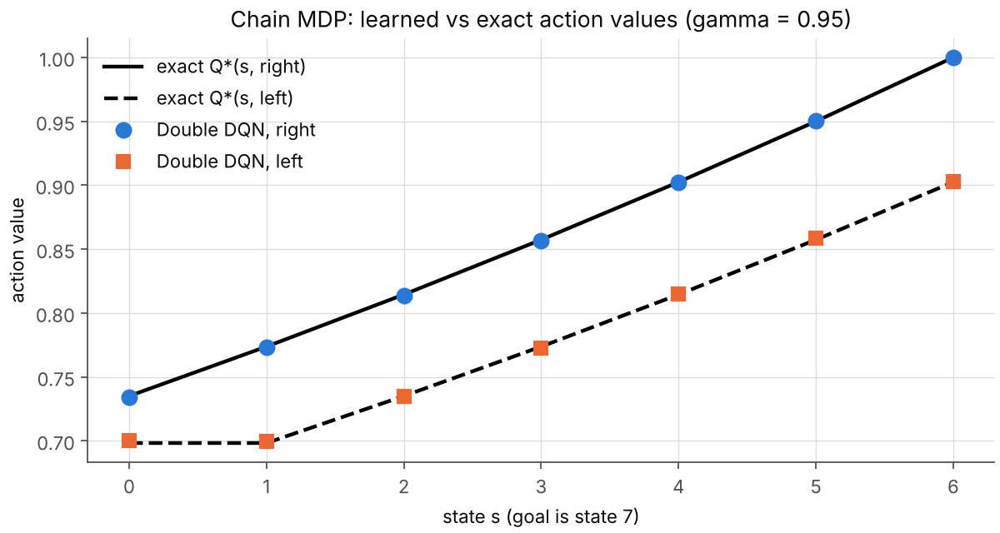{ width=60% }

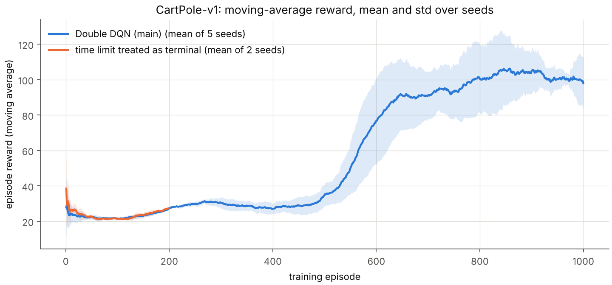{ width=78% }

## With three more months (part a)

- Repeat every configuration with 20 or more seeds and report confidence intervals for the probability that the kept network solves the task, for the episode at which it is found, and for the size of the collapse after it.
- Measure the action gap $Q(s, a_1) - Q(s, a_2)$ along training and test directly whether the collapses start when the gap falls below the noise of the updates, as argued above. Then test the remedies that act on it: prioritised replay of rare failure transitions, a replay buffer that keeps a fixed share of old episodes, a larger final $\epsilon$, a smaller final learning rate, and the advantage-learning operator that widens the gap.
- Compare the stopping or selection rule with the alternatives (fixed budget, stopping when the moving average reaches 475, selection on 100 instead of 20 evaluation episodes) by their false-positive rate on 500 fresh episodes.
- Test the learned policy beyond its training distribution: random initial states far from upright, pushes during the episode, changed pole length and mass, and the time limit raised to 5000 steps.
- Check $\gamma = 0.95$ against $\gamma = 0.99$ at equal compute: the longer horizon should remove the cart-position failures described in the edge cases.

# Part (b): MsPacman-v5

## Setup

`ALE/MsPacman-v5` with its defaults: frame skip 4, sticky actions with probability 0.25 (the previous action is repeated regardless of the agent's choice), 9 actions, at most 108,000 frames per game, 3 lives. Every frame goes through the assignment's `preprocess_observation()` unchanged (88 x 80, int8). The state is the stack of the last 4 preprocessed frames, which shows the direction in which Ms. Pac-Man and the ghosts move; after a reset the stack holds four copies of the first frame. The network divides the input by 128.

The network is the original DQN network of Mnih et al. (2013): convolution 8x8 stride 4 (16 filters), convolution 4x4 stride 2 (32), a 256-unit layer and 9 outputs. The larger Mnih et al. (2015) network is implemented as well (`--arch nature`), but on this CPU machine it trained at 140 steps per second against about 300 for the small one, so the small network gets about twice as many updates in the same time.

$\gamma = 0.99$ as prescribed. Adam (learning rate $10^{-4}$ decaying linearly towards $5 \times 10^{-5}$ over 3 million steps, $\epsilon_{\text{Adam}} = 1.5 \times 10^{-4}$), Huber loss, gradient-norm clipping at 10, minibatch 32, one update every 4 agent steps, target network copied every 1000 updates (4000 steps), replay buffer of 500,000 frames, updates start after 20,000 random steps. $\epsilon$ decays from 1 to 0.1 over the next 250,000 steps and then to 0.01 at step 1.5 million. Rewards are clipped to $[-1, 1]$ inside the Bellman target only, and a lost life ends the bootstrap (but not the game); both are edge cases below. All reported scores are raw game scores of complete games.

## Results

«MSPACMAN_RESULTS»

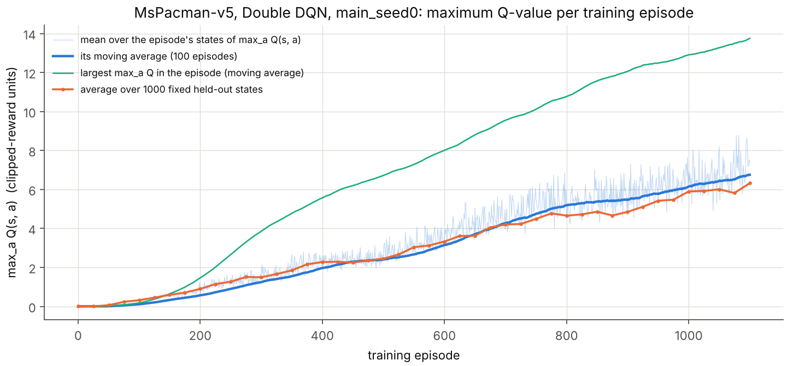{ width=78% }

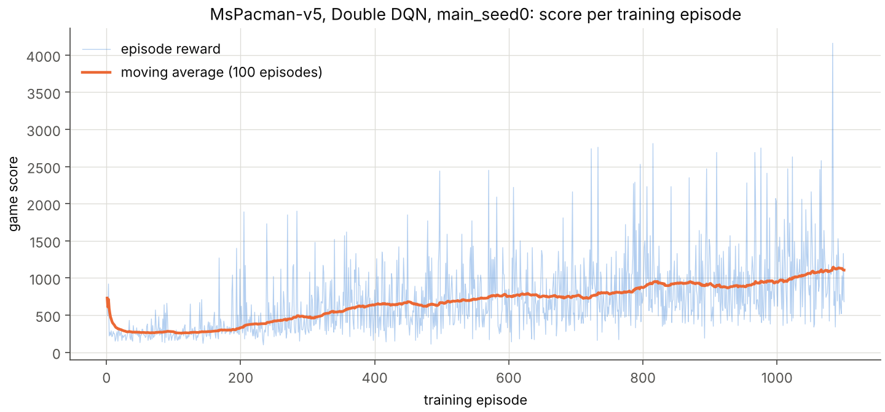{ width=78% }

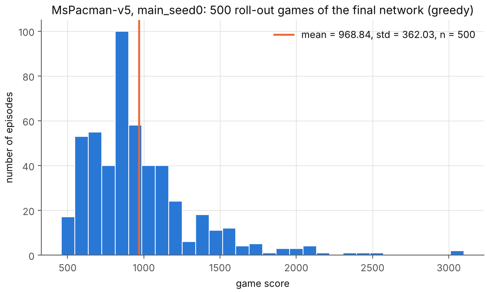{ width=62% }

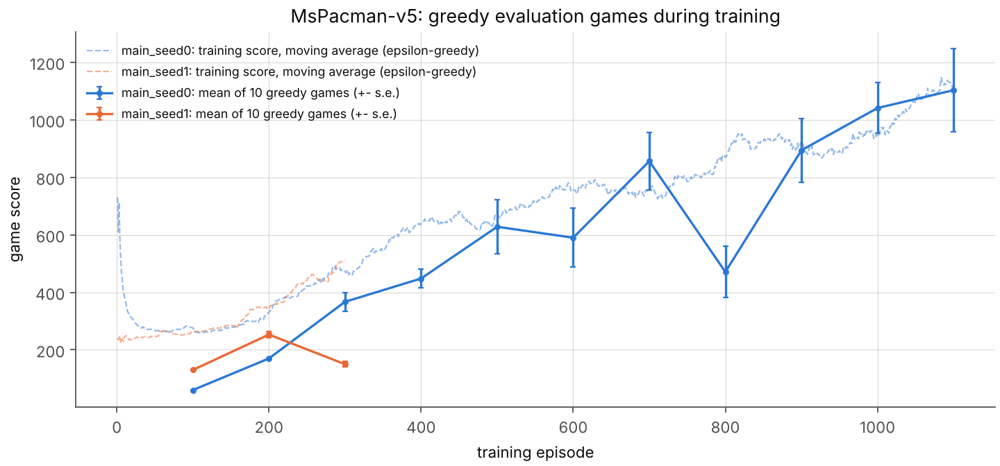{ width=78% }

## Edge cases (part b)

- **The given preprocessing function computes in unsigned integers.** The observation is `uint8`, so `img.sum(axis=2)` is `uint64` and `img // 3 - 128` wraps around to huge numbers for every pixel darker than 128 (most of the screen). The final `astype(np.int8)` keeps the lowest 8 bits, which equal the intended signed value, so the function is correct by a coincidence of modular arithmetic. It is used unchanged, and a unit test compares it with a signed computation on a random frame (identical). In a real game its output lies in $[-128, 27]$ (the brightest colour sum is 466), so the network's input $x/128$ lies in $[-1, 0.21]$.
- **The contrast trick must hit Ms. Pac-Man and nothing else.** Pixels whose colour channels sum to 448 are set to the darkest value. Over 449 frames of a random game (test P1, Figure FIG(fig_val_preprocess)) 7 to 17 pixels of the cropped frame had this sum in every frame (mean 10.7), and no pixel of any other colour had it, so exactly Ms. Pac-Man is darkened and she is never lost from the input.
- **One frame shows no motion, and states must not mix two games.** The state stacks the last 4 frames, which shows where Ms. Pac-Man and the ghosts are heading; after a reset the stack holds 4 copies of the first frame. The replay buffer stores every frame once (500,000 frames, 3.5 GB) and rebuilds the stacks at sampling time; a frame that belongs to the previous game is replaced by the first frame of the current one, the same rule as in the acting loop, and once the buffer is full the 4 oldest slots, the next to be overwritten, are never sampled because their stacks would reach into the newest frames. A unit test replays 60 random-length episodes through buffers of 37, 50 and 1000 slots (forcing wrap-around) and checks that every transition the buffer can return equals the one the acting loop saw.
- **Lives.** A game has 3 lives. A lost life ends the bootstrap (the target is the clipped reward alone), but not the game: the frame stack continues and the reported score is the full game. The crop removes the bottom of the screen where the remaining lives are drawn (checked: the bottom rows of the preprocessed frame do not change at any of the three life losses of a game), so the network cannot see how many lives are left; treating each life as an episode for the target is consistent with that.
- **Sticky actions.** With probability 0.25 the emulator repeats the previous action whatever the agent chose. The stored action is the one the agent chose, which is the action whose value the update is about; the repetition is part of the transition noise. Test P7 removes it to make the game deterministic.
- **Reward scale.** A pellet is worth 10, a power pellet 50, ghosts 200 to 1600 and fruit 100 to 5000. The target uses rewards clipped to $[-1, 1]$, so $Q$ is the discounted number of rewarding steps ahead (at most $1/(1-\gamma) = 100$) and the maximum-Q plot is in these units. The price is that a ghost is worth as much as a pellet; test P9 measures what the agent eats.
- **The time limit.** A game is truncated after 108,000 frames (27,000 agent steps). The truncation is bootstrapped like CartPole's, but it never happened: the longest training game had «MSP_MAXLEN» steps.
- **A greedy policy can get stuck.** The first two greedy evaluations (episodes 100 and 200) gave the same score in all 10 games (60 and 170, standard deviation 0) although the sticky actions make every game different: the early greedy policy runs into a wall and stays there until the ghosts end the game. $\epsilon$-greedy exploration prevents this during training, and the greedy evaluations show when the policy has outgrown it.
- **Compute.** The run had a fixed wall-clock budget of 1.7 hours. All schedules were shortened to fit it (learning starts after 20,000 steps instead of 50,000; $\epsilon$ reaches 0.01 at 1.5 million steps instead of 2.5 million), and the replay buffer, which is not part of the checkpoint (3.5 GB), is refilled for 50,000 steps when a run resumes.

## Tests that validate correctness (part b)

«MSPACMAN_TESTS»

## With three more months (part b)

- Train for the full 4000 to 6000 episodes (10 to 50 million frames) with several seeds on a GPU, and report the learning curves with confidence bands; the run here is one seed and a short budget.
- Ablate each design choice on MsPacman at equal compute: reward clipping against a log or Pop-Art normalised reward (clipping makes a ghost worth as much as a pellet), life loss as terminal or not, Double against plain DQN, the 2013 against the 2015 network, the frame stack against a max-pooled pair of frames.
- Add the standard improvements one at a time (prioritised replay, dueling network, n-step returns, noisy networks) and measure their effect on the same seeds.
- Extend the calibration test: compare $Q$ with Monte Carlo returns state by state with many roll-outs from cloned emulator states, so that the overestimation can be measured without the noise of a single trajectory.
- Probe what the network has learned with saliency maps and with controlled states (ghost placed next to Ms. Pac-Man, power pellet just eaten), and test robustness to sticky-action probability, frame skip and the other mazes of the game.
